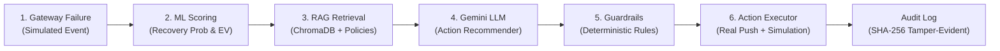
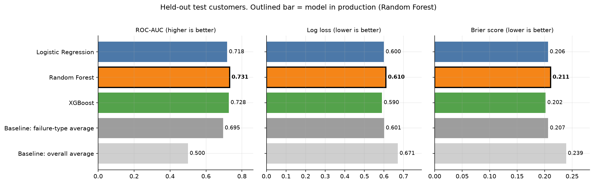
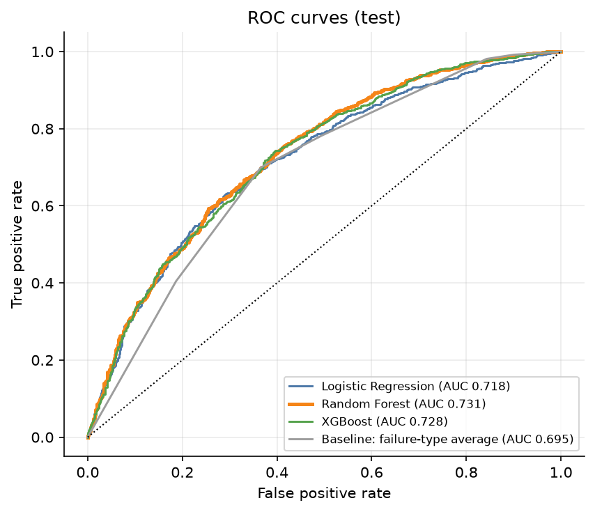
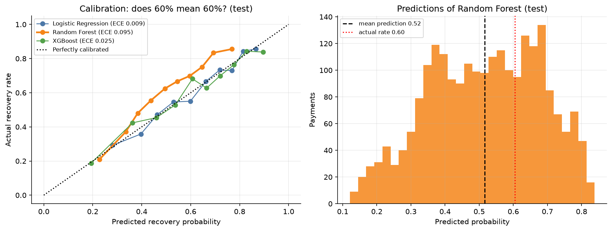
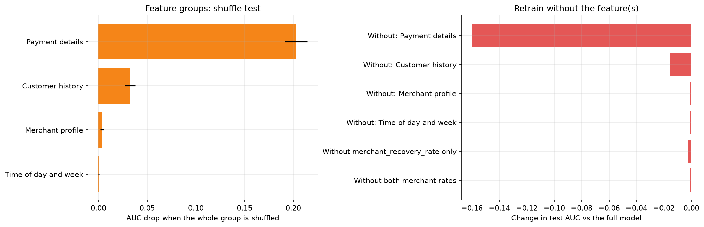
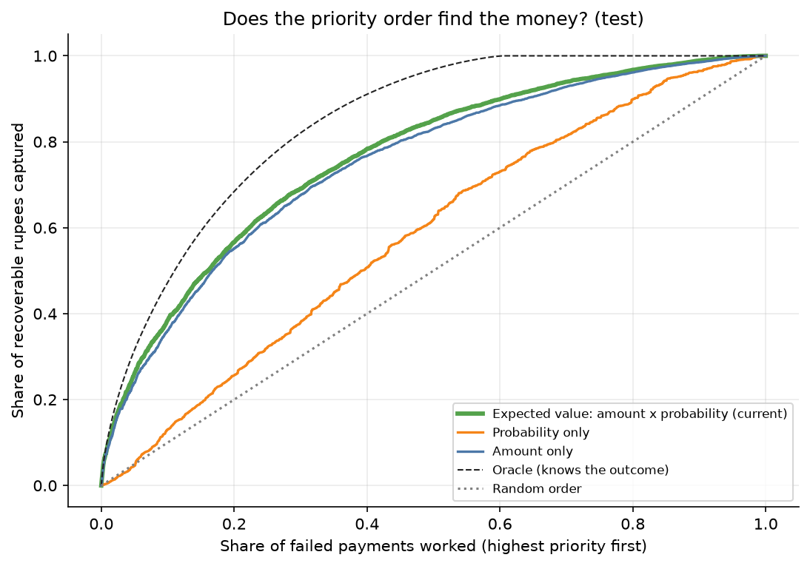

# AI Revenue Recovery Agent

An agentic system that decides what to do when a payment fails: retry, send a payment link, notify the customer, escalate, or do nothing. It combines customer-split ML scoring, RAG policy retrieval, Google Gemini reasoning, deterministic safety guardrails, real mobile push notifications, and a tamper-evident SHA-256 audit log.

> **Note:** All payment data is synthetic (generated by `data/generate_data.py`). Metrics demonstrate the pipeline and methodology, not real-world performance. Payment actions are simulated; only the push notifications are real.

## Highlights

- **Honest evaluation:** customer-level held-out split (`GroupShuffleSplit` on `customer_id`), so the model is scored only on customers it never saw. Test ROC-AUC **0.731** vs **0.695** for a failure-type-average baseline.
- **Revenue-aware prioritization:** ranking by Expected Value (Amount × P(recovery)) captures **56.7%** of recoverable revenue in the top 20% of payments (random order: 20%, oracle: 68.4%).
- **Defense-in-depth:** the LLM recommends, deterministic code decides. In red-team tests, injected unsafe `RETRY` recommendations on fraud and duplicate failures are blocked by the guardrail layer.
- **Auditable:** every run is appended to a SHA-256 hash-chained ledger, with automated tamper detection.
- **Real alerts:** phone push notifications via [ntfy](https://ntfy.sh) on every executed action.

## Tech Stack

| Layer | Tools |
|---|---|
| Backend / API | FastAPI, Uvicorn |
| Frontend | Streamlit |
| ML | scikit-learn (Random Forest, Logistic Regression), XGBoost, joblib |
| RAG | ChromaDB, `all-MiniLM-L6-v2` embeddings |
| LLM | Google Gemini (decision stage and offline LLM-as-a-judge evaluation) |
| Notifications | ntfy.sh |
| Integrity | SHA-256 hash chain |

## Table of Contents

1. [System Architecture](#system-architecture)
2. [Repository Structure](#repository-structure)
3. [Quick Start](#quick-start)
4. [Live Demo](#live-demo)
5. [Machine Learning Layer](#machine-learning-layer)
6. [Safety and Deterministic Guardrails](#safety-and-deterministic-guardrails)
7. [Model Insights Page](#model-insights-page)
8. [Reproducing the Results](#reproducing-the-results)
9. [API Reference](#api-reference)
10. [Testing](#testing)
11. [Limitations](#limitations)
12. [Future Work](#future-work)
13. [License](#license)

---

## System Architecture

The core principle is **defense-in-depth**. ML and LLM components provide probabilistic scoring and contextual recommendations; hardcoded guardrails enforce policy and compliance outside the LLM, in deterministic code.



The pipeline has **6 stages plus audit logging**.

---

## Repository Structure

```
Razor_pay_agent/
├── backend/
│   ├── actions/action_executor.py   # Action dispatcher, simulated retries, ntfy publisher
│   ├── agent/
│   │   ├── demo_pipeline.py         # 6-stage timed demo, red-teaming, SHA-256 audit chaining
│   │   └── recovery_pipeline.py     # Batch / payment-id recovery pipeline with fallbacks
│   ├── api/demo_routes.py           # REST endpoints for demo execution, status, audit checks
│   ├── evaluation/                  # LLM-as-a-judge offline evaluation (prompt, schemas, service)
│   └── main.py                      # FastAPI entrypoint
├── data/
│   ├── evaluation/                  # LLM evaluation run results (results.jsonl, runs.jsonl)
│   ├── customers.csv                # 4,736 synthetic customer profiles
│   ├── merchants.csv                # 100 merchant profiles
│   ├── payments.csv                 # 14,935 failed-payment records
│   ├── ml_dataset.csv               # Merged dataset with engineered features
│   ├── prioritized_payments.csv     # Payments scored with probability and EV
│   ├── recovery_outcomes.csv        # Ground-truth recovery labels
│   ├── recovery_audit_log.csv       # Flat audit log from batch runs
│   ├── demo_audit_log.jsonl         # Hash-chained audit ledger for live demo runs
│   └── generate_data.py             # Synthetic data generator
├── evaluation/
│   ├── figures/                     # 8 diagnostic plots
│   ├── model_report.md / .json      # Evaluation summaries
│   └── *.csv                        # Metrics, ablation, importance, priority tables
├── frontend/pages/
│   ├── 1_Live_Demo.py               # Failure injection, real push, audit verification
│   └── 2_Model_Insights.py          # Model diagnostics and data checks
├── ml/
│   ├── feature_engineering.py
│   ├── train_model.py               # Training with GroupShuffleSplit
│   ├── evaluate_model.py            # Evaluation and figure generation
│   ├── priority_engine.py           # Expected value and tier assignment
│   └── recovery_model.joblib        # Serialized production model (Random Forest)
├── rag/
│   ├── knowledge_base/              # failure_reasons.md, merchant_policies.md, recovery_strategies.md
│   ├── chroma_store/                # Persistent vector index
│   ├── rag_engine.py                # Chunking, MiniLM embeddings, retriever
│   ├── llm_agent.py                 # Gemini recommendation agent
│   └── guardrails.py                # Deterministic safety rule engine
└── tests/test_evaluation.py
```

---

## Quick Start

**Prerequisites:** Python 3.10+, and optionally the free [ntfy](https://ntfy.sh) app (iOS / Android).

### 1. Clone and install

```bash
git clone https://github.com/your-username/Razor_pay_agent.git
cd Razor_pay_agent

python -m venv venv
# Windows:      venv\Scripts\activate
# Linux/macOS:  source venv/bin/activate

pip install -r requirements.txt
```

### 2. Configure environment

Copy `.env.example` to `.env` and fill it in:

```env
# Required for the Gemini decision stage (falls back to MANUAL_REVIEW if missing)
GEMINI_API_KEY=your_gemini_api_key_here

# Optional: real phone push notifications
NTFY_TOPIC=your_long_random_topic_name
NTFY_SERVER=https://ntfy.sh

# Backend URL used by the Streamlit demo
DEMO_API_URL=http://127.0.0.1:8000
```

> **Security note:** ntfy topics on the public server are effectively public. Anyone who guesses your topic name can read its messages. Use a long, random topic, and never put sensitive data in notifications. Never commit `.env`.

### 3. (Optional) Subscribe on your phone

Install the ntfy app, tap **Subscribe to topic**, and enter the exact `NTFY_TOPIC` value.

### 4. Run

**Full stack (FastAPI + Streamlit):**

```bash
# Terminal 1
uvicorn backend.main:app --reload --port 8000

# Terminal 2
streamlit run frontend/pages/1_Live_Demo.py
```

**Standalone (in-process fallback):** if the backend is not running, the Live Demo invokes backend modules directly.

```bash
streamlit run frontend/pages/1_Live_Demo.py
streamlit run frontend/pages/2_Model_Insights.py   # model diagnostics
```

---

## Live Demo

`frontend/pages/1_Live_Demo.py` lets an operator inject a payment failure, watch each pipeline stage execute with timings, receive a real push alert, and verify audit integrity.

<!-- Add a screenshot or GIF here, e.g.:  -->

### Scenarios

| Scenario | Typical Amount | Gateway Message | Expected Policy |
|---|---:|---|---|
| `NETWORK_ERROR` | ₹60,063.19 | Gateway timeout while contacting the issuer bank. | Transient fault: `RETRY` |
| `INSUFFICIENT_FUNDS` | ₹25,000.00 | Issuer declined: insufficient funds. | Immediate retry is futile: `PAYMENT_LINK` or `NOTIFICATION` |
| `EXPIRED_CARD` | ₹12,999.00 | Issuer declined: card expired. | `PAYMENT_LINK` to update the payment method |
| `DUPLICATE` | ₹8,499.00 | Rejected: duplicate transaction reference. | Double-charge risk: `NO_ACTION` / `MANUAL_REVIEW`, no retries |
| `SUSPECTED_FRAUD` | ₹149,999.00 | Declined: risk engine flagged the transaction. | `ESCALATE` / `MANUAL_REVIEW`, retry blocked |

Custom amount, payment method, retry count, and retry outcome are also configurable.

### The 6-Stage Guarded Pipeline

1. **Payment Gateway (simulated failure):** emits an error event and borrows real feature profiles from historical transactions for full customer and merchant context.
2. **ML Prediction Engine:** the Random Forest pipeline computes recovery probability, expected recovery value (₹), and priority level.
3. **RAG Knowledge Retrieval:** queries ChromaDB with `all-MiniLM-L6-v2` embeddings for relevant excerpts from the three policy documents.
4. **Gemini LLM Decision:** receives payment context, ML probability, and retrieved policy; returns `FAILURE_EXPLANATION`, `RECOMMENDED_ACTION`, `REASONING`, `RISK`, and `AUTOMATIC_ACTION`. If credentials are missing or the call fails, it falls back to `MANUAL_REVIEW`.
5. **Deterministic Guardrails:** validates the recommended action against hardcoded rules and allows or overrides it.
6. **Action Executor and Push:** dispatches the simulated action (`RETRY`, `PAYMENT_LINK`, `NOTIFICATION`, `ESCALATE`, `MANUAL_REVIEW`) and publishes a push notification via ntfy with amount, failure type, action, and an emoji priority indicator.

### Red-Team Stress Test

The toggle **"Red-team: inject an unsafe RETRY recommendation"** bypasses the LLM and injects an adversarial `RETRY` on high-risk failures (`SUSPECTED_FRAUD`, `DUPLICATE`). The guardrail layer catches the violation and forces `ESCALATE` or `NO_ACTION`, showing that safety does not depend on the LLM behaving correctly.

### Tamper-Evident Audit Chain

Every demo run is appended to `data/demo_audit_log.jsonl`. Each record contains `run_id`, `timestamp`, `inputs`, `stages`, `summary`, `explanation`, and `prev_hash`, and is hashed over its canonical JSON form:

```
hash_n = SHA-256(record_n || hash_{n-1})
```

`verify_demo_audit()` re-computes the chain. If any line is altered, deleted, or reordered, the chain breaks and the UI reports the index where it failed. This provides tamper *evidence* (changes are detectable), not tamper *prevention*.

---

## Machine Learning Layer

The model predicts **P(recovery) ∈ [0, 1]** for each failed payment. Recovery actions drive customer communication and retries, so downstream value is estimated as:

```
Expected Recovery Value = Payment Amount × P(recovery)
```

### Dataset and Split

| Item | Value |
|---|---|
| Failed payments | 14,935 across 4,736 customers |
| Base recovery rate | 61.3% |
| Train | 10,432 (70%) |
| Validation | 2,214 (15%) |
| Test (held-out customers) | 2,289 (15%) |

Splitting is by `customer_id` (`GroupShuffleSplit`) so customer-level habits cannot leak from training into the test set.

### Model Comparison (held-out test split)

| Model | Val AUC | Test AUC | Log Loss | Brier | Brier Skill | ECE | F1 (@0.5) |
|---|:---:|:---:|:---:|:---:|:---:|:---:|:---:|
| **Random Forest** *(production)* | 0.728 | **0.731** | 0.610 | 0.211 | +11.8% | 0.095 | 0.710 |
| XGBoost | 0.734 | 0.728 | **0.590** | **0.202** | **+15.6%** | 0.025 | **0.764** |
| Logistic Regression | 0.711 | 0.718 | 0.600 | 0.206 | +13.7% | **0.009** | 0.749 |
| *Baseline: failure-type avg* | 0.670 | 0.695 | 0.601 | 0.207 | +13.6% | 0.005 | 0.722 |
| *Baseline: overall avg (61.3%)* | 0.500 | 0.500 | 0.671 | 0.239 | 0.0% | 0.008 | 0.754 |



**Why Random Forest in production?** It has the best held-out ROC-AUC (0.731), which matters most here because the system *ranks* payments for the recovery queue. Its probabilities are less calibrated (ECE 0.095) than XGBoost (0.025) or Logistic Regression (0.009), so Expected Value is used as a **ranking signal, not an exact revenue forecast**. XGBoost is the stronger choice if calibrated probabilities become the priority; isotonic or Platt calibration of the Random Forest is a straightforward alternative (see [Future Work](#future-work)).



### Calibration and Segment Behavior



Logistic Regression and XGBoost track the diagonal closely; the Random Forest compresses predictions toward the center.

Predicted vs. actual recovery by failure type (full chart: `evaluation/figures/06_actual_vs_predicted_by_segment.png`):

| Failure Type | Actual | Predicted | Direction |
|---|---:|---:|---|
| `NETWORK_ERROR` | 76.8% | 66.9% | Under-predicts |
| `TIMEOUT` | 71.6% | 58.0% | Under-predicts |
| `AUTHENTICATION_FAILURE` | 49.6% | 40.3% | Under-predicts |
| `INSUFFICIENT_FUNDS` | 46.6% | 38.8% | Under-predicts |
| `EXPIRED_CARD` | 22.4% | 30.6% | **Over-predicts** |
| `SUSPECTED_FRAUD` | 13.3% | 26.8% | **Over-predicts** |
| `DUPLICATE` | 10.5% | 19.2% | **Over-predicts** |

The model ranks segments in the correct order of recoverability. It is conservative on transient technical faults but **over-estimates** recovery for the terminal categories (expired card, fraud, duplicate). That is exactly why those cases are additionally covered by hard guardrails rather than left to the probability alone.

### Feature Importance and Ablation



| Feature | AUC drop when shuffled |
|---|---:|
| `failure_type` | 0.1811 |
| `retry_count` | 0.0195 |
| `customer_success_rate` | 0.0081 |
| `merchant_recovery_rate` | 0.0024 |

Group-level results:

- **Payment Details:** shuffling drops test AUC by 0.2028 (0.731 → 0.572). Transaction mechanics dominate.
- **Customer History:** removing it drops AUC from 0.731 to 0.716 (−0.015), a meaningful secondary signal.
- **Merchant Profile and Time:** removing either costs about 0.001 AUC, so the model is robust to missing merchant metadata.

### Priority Formulation and Revenue Capture



Ordering by Expected Value (Amount × P) gives the best practical balance between value and operational effort:

| Ordering Strategy | Top 10% | Top 20% | Top 30% |
|---|:---:|:---:|:---:|
| **Expected Value (Amount × P)** | **38.4%** | **56.7%** | **69.1%** |
| Amount only | 36.0% | 55.1% | 67.5% |
| Probability only | 13.0% | 25.6% | 37.8% |
| Oracle (upper bound) | 47.2% | 68.4% | 82.0% |
| Random | 10.0% | 20.0% | 30.0% |

The top 20% by EV captures ₹3,053,797 of ₹5,385,886 total recoverable. Probability-only ordering chases many tiny payments; amount-only ordering wastes effort on doomed high-value attempts (for example ₹150,000 fraud flags).

**Priority tiers.** Payment amounts are heavy-tailed (Pareto-like), so dividing by the single largest EV puts 98.5% of payments in `LOW` (only 6 of 2,289 in `HIGH`). Three tiering methods were compared (`evaluation/figures/08_priority_tiers.png`):

| Method | `HIGH` count | Revenue in `HIGH` |
|---|---:|---:|
| Divide by max EV (cutoffs 66/33) | 6 | n/a |
| Divide by 99th-percentile EV | 73 | 19.5% |
| Rank-based quantiles (top 10% / next 30% / rest) | 228 | 38.4% |

The system uses **rank-based quantile tiering** for queue management.

### Data Leakage Check

To verify `merchant_recovery_rate` was not computed from test outcomes: correlation with test recovery is 0.625, and the mean absolute difference is 0.0809 against ~0.0397 expected from sampling noise alone. The gap is consistent with natural variability across merchants; no evidence of target leakage was found.

Full diagnostics and the remaining figures are in `evaluation/model_report.md` and `evaluation/figures/`.

---

## Safety and Deterministic Guardrails

`rag/guardrails.py` is the hard safety boundary. It runs after the LLM and is enforced in deterministic code, so it does not depend on prompt wording or LLM behavior.

| Rule | Condition | Override | Reason |
|---|---|:---:|---|
| Fraud Suppression | `failure_type == "SUSPECTED_FRAUD"` | `ESCALATE` | No automatic recovery on flagged transactions. |
| Duplicate Suppression | `failure_type == "DUPLICATE"` | `NO_ACTION` | Duplicate charges must never be re-attempted. |
| Probability Floor | P(recovery) < 0.15 | `NO_ACTION` | Low success odds don't justify customer disruption. |
| Retry Cap | `retry_count >= 2` | `MANUAL_REVIEW` | Maximum automated retries exceeded. |
| High-Value Protection | Amount ≥ ₹50,000 and `retry_count >= 1` | `MANUAL_REVIEW` | High-value payments need human oversight after the first retry. |
| Failure-Action Compatibility | Incompatible failure/action pair | `MANUAL_REVIEW` | For example, an immediate retry on an expired card. |

Rules are evaluated in the order listed, and the first violation determines the override.

---

## Model Insights Page

`frontend/pages/2_Model_Insights.py` offers interactive analysis for data scientists and risk managers:

1. **Why This Model:** model comparison, ROC curves, reliability diagrams.
2. **Which Features Matter:** permutation importance and group ablation tables.
3. **How Priority Is Set:** revenue capture curves and tier distribution comparisons.
4. **Data Checks:** automated target-leakage validation for merchant recovery rates.

---

## Reproducing the Results

```bash
# 1. Regenerate synthetic data
python data/generate_data.py

# 2. Build features and train the model (GroupShuffleSplit by customer_id)
python ml/train_model.py

# 3. Evaluate and regenerate figures and tables in evaluation/
python ml/evaluate_model.py

# 4. Score and prioritize payments
python ml/priority_engine.py
```

The ChromaDB index in `rag/chroma_store/` is built from `rag/knowledge_base/*.md` by `rag/rag_engine.py`. Delete the folder to force a rebuild.

---

## API Reference

### Demo endpoints

| Endpoint | Description |
|---|---|
| `GET /demo/scenarios` | Failure scenarios, payment methods, retry outcome options |
| `GET /demo/status` | Readiness: model artifacts, ntfy connectivity, audit chain integrity |
| `POST /demo/test-push` | Send a test notification to the configured ntfy topic |
| `POST /demo/run` | Execute a full 6-stage guarded recovery run |
| `GET /demo/audit` | Historical runs from the hash-chained ledger |
| `GET /demo/audit/verify` | Validate the SHA-256 chain |

Example `POST /demo/run` body:

```json
{
  "failure_type": "NETWORK_ERROR",
  "amount": 25000.0,
  "payment_method": "UPI",
  "retry_count": 0,
  "retry_outcome": "sample",
  "red_team_retry": false,
  "send_push": true
}
```

### Recovery pipeline endpoints

| Endpoint | Description |
|---|---|
| `GET /payments` | List prioritized payments |
| `GET /payments/{payment_id}` | Transaction details |
| `POST /payments/{payment_id}/recover` | Run recovery for one transaction |
| `POST /recover/batch?limit=10` | Batch recovery simulation |
| `GET /metrics` | Aggregated recovery financial metrics |

---

## Testing

```bash
pytest tests/
```

Current coverage focuses on evaluation schemas and metrics (`tests/test_evaluation.py`). Unit tests for each guardrail rule (including the red-team `RETRY` cases) are planned, since guardrails are the core safety claim.

---

## Limitations

- **Synthetic data:** results reflect the data generator, not real Razorpay traffic. Real data would need re-validation, drift monitoring, and recalibration.
- **Calibration:** Random Forest probabilities are under-calibrated (ECE 0.095). EV is used for ranking, not as an exact forecast. Probabilities for terminal failure types (expired card, fraud, duplicate) are over-estimated.
- **Simulated execution:** retries, payment links, and notifications to customers are simulated; only operator push alerts are real.
- **Single LLM, single turn:** no multi-turn customer interaction, and LLM output quality depends on retrieved policy text.
- **Audit log scope:** the hash chain detects modification but cannot prevent it, and it does not protect against an attacker who rewrites the whole chain.

## Future Work

- Calibrate the Random Forest (isotonic or Platt) or move to XGBoost for the production scorer.
- Add guardrail unit tests and property-based tests.
- Anchor audit-chain head hashes externally (for example a signed checkpoint) for stronger tamper evidence.
- Validate on real transaction data and add drift monitoring.
- Add a real-time gateway webhook integration in place of simulated failure events.

## License

Add a license (for example MIT) in a `LICENSE` file and reference it here.
